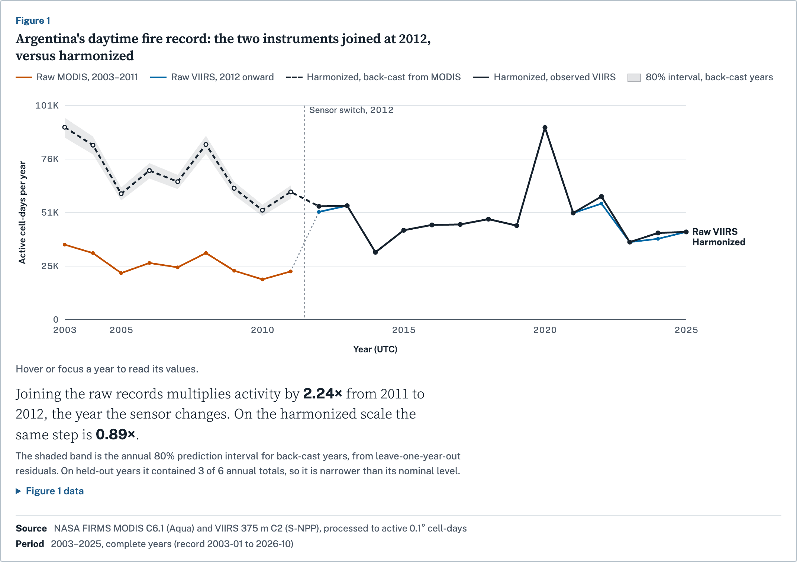
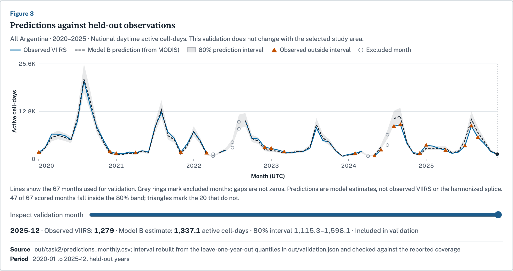
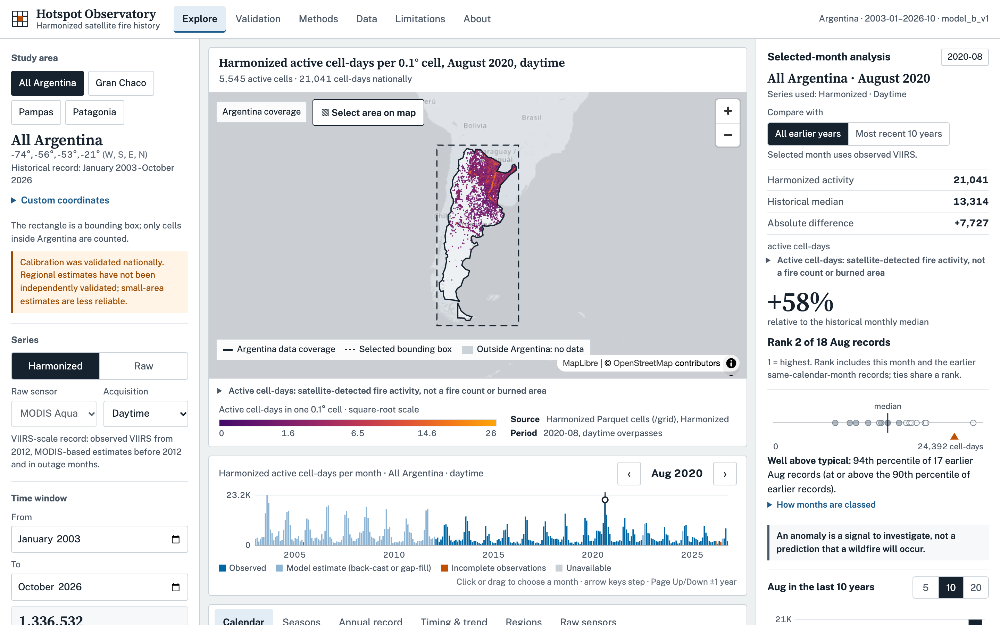

# Hotspot Observatory

**One consistent fire record for Argentina from two NASA satellites, 2003–2026.**

NASA has detected fires from orbit with MODIS since 2002 and with the sharper VIIRS
instrument since 2012. VIIRS records about **2.75 times** as many active fire cells over
Argentina, so a record that switches instruments shows a **false 2.24× jump in 2012** that
distorts every trend, anomaly and seasonal comparison crossing that year.

Hotspot Observatory calibrates MODIS to the VIIRS scale, tests the calibration on years it
was never fitted to, and publishes one harmonized monthly record of satellite-detected fire
activity for Argentina (January 2003 – October 2026, 0.1° grid) inside an interactive
analysis tool. On the harmonized scale the 2012 step is 0.89× instead of 2.24×.

NASA Space Apps Challenge 2026, Chicago local event.



## Who it is for

| User | Question | Where in the tool |
|---|---|---|
| Climate scientists, fire researchers, environmental agencies | When and where does fire activity peak, and is that changing? | Seasons, Regions and Timing & trend tabs |
| Fire analysts, monitoring agencies, early-warning teams | Is this month unusually high or low compared with history? | Timeline and the selected-month inspector |
| Emergency-response and fire-management agencies, climate modellers | Which areas are persistently active, and in which months? | Map, Calendar and CSV export |

Examples from the record: Patagonia's fire season peaks in February, while Gran Chaco and the
Pampas peak in August. August 2020 was 58% above the historical August median nationally,
the second highest of 18 Augusts. An anomaly is a signal to investigate, not a prediction
that a wildfire will occur.

## Results

Calibration fitted on 2012–2019 (both satellites flying) and scored on held-out years
2020–2025 (67 complete, non-gap months), national daytime active cell-days:

| | Monthly error (MAPE) | Monthly R² | Annual error (MAPE) |
|---|---:|---:|---:|
| Raw MODIS (no correction) | 65.7% | 0.10 | 62.5% |
| Constant ratio (model A) | 16.0% | 0.92 | 6.5% |
| **Power law (model B, selected)** | **12.4%** | **0.97** | **6.4%** |

- **2012 join:** observed VIIRS for Feb–Dec 2012 differs from model B by +0.04%, inside the annual 80% band.
- **Uncertainty, measured:** the nominal 80% monthly prediction interval covered 70% of held-out months (47 of 67), so it is narrower than nominal. We report this rather than assume 80%.



## Using the tool



The top bar switches between six views: **Explore** (the workspace), **Validation**,
**Methods**, **Data**, **Limitations** and **About**.

In **Explore**:

- **Left panel (controls):** study area (presets, typed coordinates, or a rectangle drawn on the map), series (harmonized or one raw instrument; day or night), time window, CSV export and *Copy link to this view*.
- **Centre:** a map of active 0.1° cells for the selected month; a monthly timeline (click, drag or use the arrow keys to choose a month); and analysis tabs: Calendar, Seasons, Annual record, Timing & trend, Regions and Raw sensors.
- **Right panel (inspector):** the selected month against the same month in earlier years (value, median, % change, rank, percentile class), a choice of all earlier years or the 10 most recent as the baseline, that month across the last 5, 10 or 20 years, and its data quality.

Every value is labelled observed, back-cast, gap-filled, incomplete or provisional, and
comparisons that would rely on incomplete observations are withheld. The address bar holds
the full analysis state, so any view can be bookmarked or shared.

**The unit is active 0.1° cell-days**: one grid cell (about 11 km north–south and 6–10 km
east–west across Argentina) with at least one satellite fire detection on one UTC day,
counted separately for each instrument. It measures satellite-detected activity, not the
number of fires or the area burned.

## Run it locally

Prerequisites: Git, Python 3.12, Node.js 22.11+ with npm. From the repository root:

```sh
python3.12 -m venv app/.venv
app/.venv/bin/python -m pip install -r app/api/requirements.txt
npm --prefix app/web ci
```

Start the API (terminal 1) and the web app (terminal 2):

```sh
app/.venv/bin/python -m uvicorn app.api.main:app --host 127.0.0.1 --port 8000
npm --prefix app/web run dev
```

Open **http://127.0.0.1:5173**. API documentation: http://127.0.0.1:8000/docs.
No API key or raw downloads are needed: the processed datasets are in this repository.
`DATA_PATH` is optional; it selects another data file, for example
`fixtures/synthetic_harmonized.parquet` for development, which the app labels as synthetic.

## How it works

1. **Filter detections.** MODIS: Aqua, confidence ≥ 30. VIIRS: Suomi-NPP, confidence not low. Both: type 0 (presumed vegetation fire).
2. **Grid and count.** Each detection is assigned to a 0.1° cell; a cell counts once per UTC day per instrument. Counting cells rather than raw detections removes most of the pixel-size difference, which was chosen after a diagnostic comparison of both sensors (`out/diagnostics_2019.md`).
3. **Flag outages.** A day is a gap day for a sensor when it has no detections in Argentina while the reference sensor does; months with more than 3 gap days are flagged and excluded from fitting and scoring.
4. **Fit four competing models** on national monthly daytime cell-days, 2012–2019: constant ratio, power law, power law with month terms, and power law per 2° block.
5. **Score them on held-out years** 2020–2025 and select model B:
   `log(1 + VIIRS) = 1.6622 + 0.91414 · log(1 + MODIS)`
6. **Estimate uncertainty** from leave-one-year-out refits (80% interval) and measure its coverage on held-out months.
7. **Build the record.** Observed VIIRS wherever it exists; model B from MODIS only for daytime 2003–2011 (back-cast) and for VIIRS outage months (gap-fill: 2012-01, 2022-07, 2022-08, 2024-07, 2026-07). Night is VIIRS only, from 2012. Each modelled national value is spread over cells in proportion to MODIS cell-days.
8. **Append the live year** from the FIRMS API (standard processing, then near-real-time), clipped to the Argentina border. A 2026 outage is filled only after confirming the satellite returned no data worldwide while NOAA-20 did.

The pipeline refits model B and stops unless it reproduces the published coefficients and
scores, and checks that cells sum to the national value in every month. Full details are
in the app's Methods view, `contracts/harmonized_schema.md` and `out/task2/report.md`.

## Data

| Source | Use |
|---|---|
| [NASA FIRMS](https://firms.modaps.eosdis.nasa.gov/) MODIS Collection 6.1 (MCD14ML), Aqua, yearly country archives | MODIS record 2003–2025 |
| NASA FIRMS VIIRS 375 m Collection 2 (VNP14IMGML), Suomi-NPP, yearly country archives | VIIRS record 2012–2025 |
| [FIRMS Area API](https://firms.modaps.eosdis.nasa.gov/api/area/) | 2026 MODIS and VIIRS, standard then near-real-time |
| FIRMS MODIS Terra and VIIRS NOAA-20 | References only, to confirm outages |
| [Natural Earth](https://www.naturalearthdata.com/) Admin-0 boundaries | Clipping to Argentina; map outline |
| [OpenStreetMap](https://www.openstreetmap.org/copyright) | Basemap tiles (display only) |

Processed outputs in `out/`: `harmonized.parquet` (cell × month × day/night),
`national_monthly.parquet`, `validation.json` (scores, intervals, gaps, limitations) and
`task2/` (model comparison and held-out predictions).

## Limitations and next steps

- **Validated nationally.** Scores measure agreement with VIIRS for all of Argentina, not independent ground truth and not individual regions. Regional values and intervals are scaled national results. From 2012 most months are observed VIIRS, so this matters mainly for modelled months.
- **Overpass drift.** From 2023 Aqua's daytime overpass moves later (about 14:31 local solar time in 2024 and 15:02 in 2025, against about 13:50 for Suomi-NPP), and model B over-predicts 2024 and 2025 by about 12%. Modelled months since 2023 (2024-07, 2026-07) are likely high.
- **Intervals are narrow:** 70% measured coverage against 80% nominal.
- **Modelled maps follow MODIS.** In back-cast and gap-filled months, 90 cell-months exceed the days in their month, so modelled cell values are relative activity rather than literal day counts.
- **Provisional data.** Near-real-time months (2026-08 to 2026-10) may change when NASA reprocesses them.

Next steps: regional validation, a drift-aware recalibration, recalibrated interval width,
province-level areas, automated updates, and other countries, each with its own validation.

## Tests

```sh
app/.venv/bin/python -m pytest app/api -q      # 90 backend tests
npm --prefix app/web run test:unit             # 23 unit tests
npm --prefix app/web run test:install          # once: installs Chromium for Playwright
npm --prefix app/web run test:e2e              # 30 end-to-end tests
```

The tests check that every displayed number traces to the data: map cells sum to the
regional series, rebuilt intervals reproduce the reported coverage, anomaly medians and
ranks recompute from their baseline, and exports match the API.

## Repository

```text
app/api/        FastAPI read-only API and backend tests
app/web/        React + Vite + MapLibre workspace, unit and Playwright tests
contracts/      Harmonized data schema and provenance contract
pipeline/       Calibration, diagnostics, live-year fetch and harmonization scripts
out/            Processed NASA-derived data and validation results
fixtures/       Argentina boundary and a labelled synthetic development dataset
docs/demo/      Demo slides and screenshots
```

Regenerating the data (optional; needs a free FIRMS MAP_KEY in `FIRMS_MAP_KEY`):
`bash get_rest.sh Argentina`, then `pipeline/calibration.py`, `pipeline/fetch_firms.py`,
`pipeline/fetch_firms.py --coverage-check` and `pipeline/harmonize.py`.

## Use of AI

All of the code in this project was generated with AI coding assistants under our team's
direction. Our team defined the approach: put both instruments on one scale by calibrating
MODIS against VIIRS on the years both satellites flew, and test the calibration on held-out
years. We chose the use cases, specified what to build, reviewed the outputs and checked
results against NASA FIRMS data. OpenAI Codex implemented the data-processing and
calibration pipeline; Claude (Anthropic) implemented the API, the web application and the
automated tests. The processed datasets in this repository were produced by that
AI-generated code.
